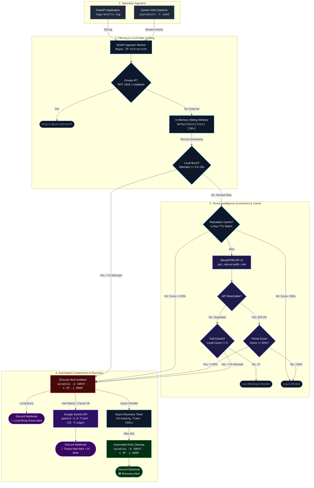

# Lightweight Python SOAR Engine (SecOps)

The early stages of a lightweight Security Orchestration, Automation, and Response (SOAR) pipeline built in Python. Designed for rapid threat detection, automated threat intelligence enrichment, and host-level containment with minimal system overhead.

```mermaid
flowchart LR
    %% Styling
    classDef default font-family:ui-monospace,monospace,font-size:13px;
    classDef step fill:#0f172a,stroke:#38bdf8,stroke-width:1.5px,color:#f8fafc;
    classDef block fill:#450a0a,stroke:#ef4444,stroke-width:2px,color:#f8fafc;
    classDef alert fill:#3b0764,stroke:#d8b4fe,stroke-width:1.5px,color:#f8fafc;

    S1["<b>1. Loggkilder</b><br/>(Log Sources)"]:::step
    S2["<b>2. SOAR-engine</b><br/>(SOAR Engine)"]:::step
    S3["<b>3. IP-oppslag</b><br/>(Threat Intel)"]:::step
    S4["<b>4. Isolering</b><br/>(Host Containment)"]:::block
    S5["<b>5. Varsling</b><br/>(Notification)"]:::alert

    S1 -->|Innsamling| S2
    S2 -->|Trusselvurdering| S3
    S3 -->|Aktiv motstand| S4
    S4 -->|Rapportering| S5
```



## Architecture & Workflow

1. **Ingestion:** FastAPI endpoint simulates an exposed web application logging client login attempts (`alerts.log`). Also monitors host-level SSH authentication events continuously via `journalctl -t sshd`.
2. **Parsing & Triage:** Python worker continuously tails the log streams and extracts client IP addresses using regex.
3. **Enrichment, Rate-Limiting & Reputation Cache:**
   - **Local Brute-Force Fallback:** Tracks incoming attempts per external IP in a thread-safe sliding window (`LOCAL_BURST_THRESHOLD = 5` within `LOCAL_BURST_WINDOW = 30s`). If an IP hits the burst threshold, it is dropped immediately via `iptables` without waiting on external APIs.
   - **In-Memory Reputation Cache (1h TTL):** Caches previous AbuseIPDB verdicts (`reputation_cache`). Repeated attacks from known malicious IPs are dropped immediately on attempt #1, even if the external API is offline or degraded.
   - **External Intelligence:** On a cache miss, queries the **AbuseIPDB API** to check the global reputation score and report history. If the API times out or is degraded, the engine fails closed using the local counter.
4. **Automated Response:** If the threat score exceeds the defined threshold (e.g. 50%), the engine automatically executes an OS-level `iptables` DROP rule to isolate the host. An async timer (`threading.Timer`) with a defined threshold in seconds (e.g 60s) removes the block rule (`iptables -D`) after said time. The IP address and contextual information is also sent to `gemini-3.8-flash` that acts as a tier 1 SOC analyst, creating a brief summary of the threat. A discord webhook fires alerts on threat mitigation and recovery, including the AI-summary and intelligence source (Live vs. Cache). 


  

## Tech Stack
* **Language:** Python 3.12
* **Web Framework:** FastAPI / Uvicorn
* **Threat Intelligence:** AbuseIPDB v2 REST API
* **AI Incident Triage:** Google Gemini API (`gemini-3.8-flash` via `google-genai` SDK)
* **Host Containment:** Linux `iptables` (asynchronous subprocess orchestration)
* **Telemetry & Ingestion:** `systemd-journald` (`journalctl -t sshd`) & application log tailing
* **Alerting & Notification:** Discord Webhook API

### Testing & Simulation
Run simulated attacks using the provided helper script:
```bash
# Single threat intel test via FastAPI
./scripts/test-attack.sh 185.220.101.5 fastapi

# Single threat intel test via SSH journal
./scripts/test-attack.sh 185.220.101.5 ssh

# Local brute-force test (fires 6 rapid requests to test local burst containment)
./scripts/test-attack.sh 203.0.113.50 fastapi brute
./scripts/test-attack.sh 203.0.113.50 ssh brute
```
* **Operating System:** Linux OS with `systemd` (Tested on Fedora Linux)
* **Python Runtime:** Python 3.10+ (with virtual environment support)
* **Host Permissions:** `sudo` privileges (required to apply and delete `iptables` containment rules)
* **API Credentials & Webhooks (in `.env`):**
  * AbuseIPDB API v2 Key
  * Google Gemini API Key
  * Discord Channel Webhook URL

